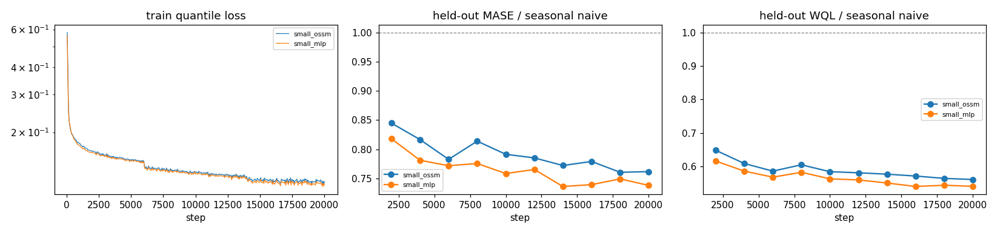
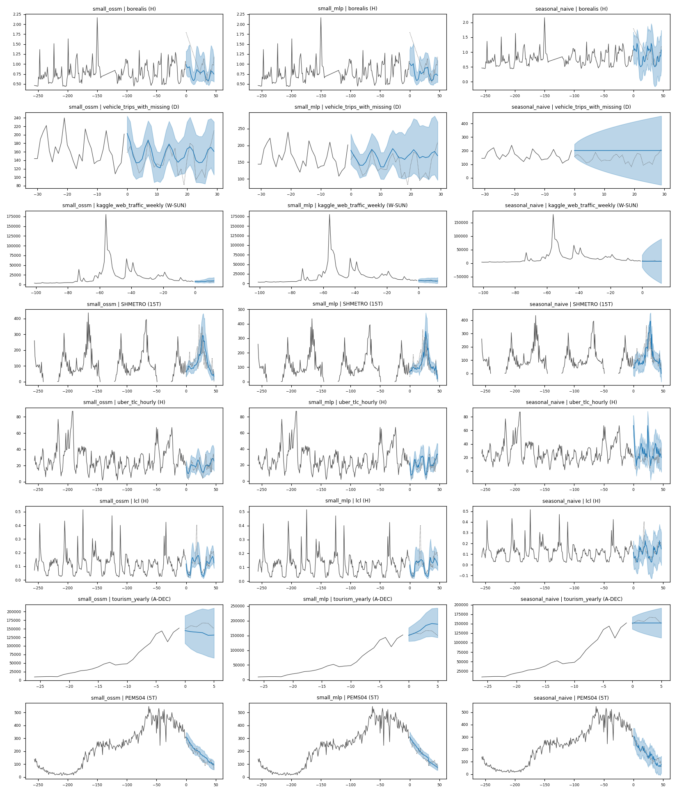

# OSSM-TSFM: a t0-style forecasting transformer with an Observer State-Space read-out

A small time-series foundation model prototype (~7–8M parameters) trained on synthetic data and a subset of
[GiftEvalPretrain](https://huggingface.co/datasets/theforecastingcompany/GiftEvalPretrain), evaluated zero-shot on
[GIFT-Eval](https://github.com/SalesforceAIResearch/gift-eval) and [fev-bench](https://github.com/autogluon/fev)
against naive baselines and published foundation models.

The encoder follows t0-alpha / Chronos-2 (patch transformer alternating time and variate attention, 21 quantiles).
The prediction head is the object of study: instead of decoding each patch representation in parallel with an MLP
(t0), an **Observer State-Space Model** (OSSM, Brachet et al. 2026, *Correct then Forecast*) reads the encoded
patches sequentially, *corrects* a latent state with every observed patch and *propagates* it autonomously through
masked patches and the forecast horizon. Both heads are implemented and compared under identical training.

## Repository

```
configs/small.yaml                 model / data / curriculum / training configuration (local run)
scripts/prepare_real.py            download + rebalance + store a GiftEvalPretrain subset as a flat memmap
scripts/generate_kernel_bank.py    precompute KernelSynth Gaussian-process samples
scripts/search.py                  OSSM transition / observer / readout search (8k-step runs, early stopping)
scripts/data_mixture.py            nominal and effective share of every training source
scripts/plot_forecasts.py          learning curves and forecast fans of checkpoints
scripts/plot_synthetic.py          samples of every training source
tsfm/model/layers.py               RMSNorm, RoPE, QK-norm attention, SwiGLU, residual block
tsfm/model/model.py                TSFM: causal scaling, patch embedding, time / variate attention, loss, forecast
tsfm/model/heads.py                quantile decoder, MLP head (t0), OSSM head (all variants), mixture head
tsfm/data/synthetic.py             KernelSynth, TSI, ETS/AR, linear state-space systems, multivariatizers, covariate effects
tsfm/data/real.py                  GiftEvalPretrain reader (dataset rebalancing, TSMixup)
tsfm/data/loader.py                task builder (crop, horizon, contiguous patch masking), curriculum, batch stream
tsfm/train.py                      training loop (AdamW, warm-up + cosine, bf16), periodic zero-shot validation
tsfm/forecaster.py                 inference API (targets + past-only + known-future covariates)
tsfm/eval/                         baselines, held-out validation, GIFT-Eval and fev-bench runners, summaries
tests/                             no-leak / causality, padding invariance, OSSM initialisation and stability, data
results/                           benchmark CSVs of our models, search table, figures
```

## Quick start

```bash
pip install -r requirements.txt
python scripts/prepare_real.py                      # ~1.3 GB download, 0.42 GB stored in data/real
python scripts/generate_kernel_bank.py --n 10000    # KernelSynth bank in data/synthetic
python -m pytest -q tests
python -m tsfm.train configs/small.yaml run_name=my_run model.transition=selective model.selective_bc=true
python -m tsfm.eval.gift_eval --model checkpoints/my_run/model.pt   # needs the GIFT-Eval data, see below
python -m tsfm.eval.fev_bench --model checkpoints/my_run/model.pt   # fev-bench mini (20 tasks)
```

Any config entry can be overridden on the command line (`section.key=value`). Training writes
`checkpoints/<run>/model.pt` (latest) and `best.pt` (weights + full config + step). Trained weights are not
versioned (~30 MB each) and can be shared separately; a checkpoint reloads in one line:

```python
from tsfm.forecaster import Forecaster

forecaster = Forecaster.from_checkpoint("checkpoints/my_run/model.pt")
quantiles = forecaster.predict(
    [{"target": y, "past": past_covariates, "future": known_future_covariates}],  # [n, T], [n, T], [n, T + H]
    horizon=48, quantile_levels=[0.1, 0.5, 0.9])                                 # -> [n_targets, 48, 3] per item
```

Benchmark data and reference results:

```bash
hf download Salesforce/GiftEval --repo-type dataset --local-dir data/gift_eval
for m in Seasonal_Naive Naive t0-alpha Chronos-2 TiRex chronos_bolt_small; do
  curl -sL https://raw.githubusercontent.com/SalesforceAIResearch/gift-eval/main/results/$m/all_results.csv \
       -o results/gift_eval_reference/$m.csv --create-dirs; done
python -m tsfm.eval.summarize_gift_eval "results/gift_eval/*.csv" "results/gift_eval_reference/*.csv"
```

fev-bench data is downloaded on the fly by `fev`; pass `--tasks tsfm/eval/resources/fev_bench_tasks.yaml` for the
full 100 tasks. `tsfm/eval/resources/` contains the fev-bench task lists (autogluon/fev) and the GIFT-Eval dataset
properties (SalesforceAIResearch/gift-eval), both Apache-2.0; `tsfm/eval/gift_eval.py` reproduces the GIFT-Eval
split logic without its dependencies.

## Architecture

**Input and scaling.** A task is a group of variates of one series, each with a role: target, past-only
covariate, known-future covariate (`[batch, variates, time]`, padded variates allowed). Values are scaled per
variate with *causal* running mean / std (t0) followed by `asinh`; known-future covariates use statistics over
their whole span. A forecast issued at the end of patch `p` is scored in the space of the statistics frozen at
that boundary, so nothing after the cutoff reaches the model through scaling. Missing values are masked out of
the statistics, inputs and loss. The scale is floored at `1e-3·|mean|` and falls back to 1 for an exactly-zero
context (with a tiny absolute floor, an all-zero history produced quantiles of ~1e9 after de-scaling).

**Encoder (t0-alpha, scaled down).** Patches of 16 steps embedded from `[values, in-patch time index, mask]` by a
residual block plus a role embedding, then `2 × [time, time, variate]` attention layers (d_model 256, 4 heads,
SwiGLU 1024, pre-RMSNorm, QK-norm, final RMSNorm). Time attention uses RoPE, is causal for targets and past
covariates and bidirectional for known-future covariates, and never reads the left padding before a row's first
visible patch. Variate attention is asymmetric: known-future covariates only read known-future covariates (no
two-hop leak of target information). Forecasts are exactly invariant to left padding, hence to batch composition
(tested).

**MLP head (t0 reference, `model.head=mlp`).** The encoding `e_p` of patch `p` is decoded into the 16 × 21
quantiles of patch `p+1` by a residual block `D` (256 → 1024 → 336 with a linear skip), monotone by construction.

**OSSM head (`model.head=ossm`).** With `h_p` the measurement (`e_p`, or `ReLU(W e_p)` with `d_hidden`):

```
x_{p+1} = A_p x_p + m_p L_p (h_p − C_p x_p) + B_p (B_pk u^pk_p + B_fk u^fk_{p+1})
patch p+1 ~ D(C_p x_{p+1})        (optionally D(ReLU(C_p x_{p+1})))
```

- `m_p = 1` iff patch `p` is visible: masked spans, missing patches and the horizon have `m_p = 0` and the state
  runs free with the same transition (*regime consistency*).
- Covariates are *control inputs*, targets are *measurements*: `u^pk_p` is a multi-head attention of `e_p` over
  the visible past-only covariates at patch `p`, `u^fk_{p+1}` an attention of `e_p` over the known-future covariates
  at the predicted patch, with a learned null slot. Queries come from patch `p` only (no leak) and the weights do
  not depend on the state, so the recurrence stays linear in `x`.
- Every target runs its own OSSM (shared weights); the recurrence is a float32 loop over patches (5–15% of a step).

| option | values | meaning |
|---|---|---|
| `transition` | `dense` | learned dense A, initialised with spectral radius `rho_a` |
| | `modal` | block-diagonal 2×2 rotation-scaling blocks `r_k e^{±iθ_k}`, `0 < r_k < 1` by construction, frequencies seeded on seasonal periods aliased to the patch grid; 4 Jordan blocks `[r, κ; 0, r]` for level / trend |
| | `selective` | modal blocks whose radii, angles and trend couplings are shifted by a linear map of `e_p` (series-dependent, causal; starts as `modal`) |
| `observer` | `free` | learned gain `L`, initialised so that `ρ(A − LC) = rho_observer` exactly (`L = (A − M)C⁺`, `ρ(M) = rho_observer`) |
| | `controlled` | error dynamics `M` learned (modal, radius `rho_observer` at init) and `L_p = (A_p − M) C_p⁺`, so that `A_p − L_p C_p = M` for every input |
| `selective_bc` | `true` / `false` | control and readout gains depending on `e_p`: `B_p = diag(g_B)`, `C_p = C diag(g_C)`, `g = exp(tanh(W e_p))` |
| `decoder` | `mlp` / `linear` | quantile decoder `D`: the t0 residual block, or a single matrix (the readout of the OSSM paper) |
| `readout_activation` | `null` / `relu` | decoder input `C_p x` or `ReLU(C_p x)` (the innovation stays linear) |
| `a_cap`, `d_hidden`, `couple_targets`, `covariate_pooling`, `mask_correction` | | spectral cap of a dense A, lifted measurement, mean-field coupling of the targets, mean pooling of covariates, correction with masked patches (ablations) |

**Mixture head (`model.head=mixture`).** MLP and OSSM heads on the same encoder; a gate `g = σ(MLP(e_p))` per
series and patch gives `g q^OSSM + (1 − g) q^MLP` (a quantile average, still monotone); each expert keeps its own
loss term (weight 0.5).

**Loss and inference.** Next-patch pinball loss over 21 quantiles (0.01 … 0.99) at every patch boundary of every
target row, averaged per row then over rows (t0); covariates are never scored. At inference the horizon is
appended as blank patches and decoded in one pass, then de-scaled with the statistics at the cutoff.

## Data and curriculum

| pool | source | what it teaches |
|---|---|---|
| univariate | GiftEvalPretrain subset (71 sources, 29k series, yearly → 4 s) | real dynamics, missing values |
| univariate | TSMixup of real windows (Chronos) | convex combinations of patterns |
| univariate | KernelSynth (Chronos): GP with composed kernels | smooth structure, seasonality |
| univariate | TSI (Chronos-2): trend × seasonality × irregular, spikes, counts, intermittency | trends, multiple seasonalities |
| univariate | ETS / AR(p) / ARIMA(p,1,0) | classical stochastic processes |
| univariate | linear SSM in modal form (damped oscillators, slow / fast real modes) | latent linear dynamics |
| multivariate | linear SSM with several outputs and exogenous inputs → targets, past and known-future covariates | shared latent state, causal input → output |
| multivariate | multivariatizers (Chronos-2): cotemporaneous mixing, lead-lag, cointegration | cross-variate dependencies |
| multivariate | covariate effects (t0): events with lead / lag response, spikes, drivers, steps, decoys | how covariates move a target |
| multivariate | real series with several targets or past covariates | |

Over the whole run (`scripts/data_mixture.py`; nominal = share of the token budget, effective = share of
non-padding patches): real-derived 38.2% / 30.4% (GiftEvalPretrain 26.6% / 22.7%, TSMixup 11.6% / 7.7%), SSM
synthetic 19.6% / 23.2%, other synthetic 42.3% / 46.5%. Real sources are drawn ∝ #series^0.5 (≤ 3% each).
Excluded: ERA5 / CMIP6 (huge, homogeneous; also excluded by t0), BuildingsBench-900k, Azure VM traces, Q-TRAFFIC,
redundant LargeST years; and, to keep fev-bench zero-shot, the sources overlapping its tasks (m5, favorita,
GFC12/14/17, KDD-cup 2022, FRED-MD). At most 1000 series per source, last 4096 steps, 5% held out.

A batch is univariate (1 target per series) or multivariate (≤ 8 variates per series, targets first, then a
random subset of covariates); the token budget is constant (16,384 patches). In every window a trailing horizon is
blanked for targets and past covariates (known-future covariates stay visible), and with probability 0.5 a
contiguous span of 1–8 patches is blanked inside the context (contiguous patch masking, TiRex / t0).

| steps | window | max blanked horizon | multivariate batches |
|---|---|---|---|
| 0 – 6k | 512 | 8 patches (128 steps) | 10% |
| 6k – 14k | 1024 | 16 patches (256 steps) | 20% |
| 14k – 20k | 2048 | 32 patches (512 steps) | 40% |

## Evaluation

- `tsfm/eval/validation.py`: held-out GiftEvalPretrain series (58 sources), last window, at the GIFT-Eval short-term
  horizon and at 10× that horizon; MASE and WQL relative to seasonal naive (geometric mean over sources).
- `tsfm/eval/gift_eval.py`: the 97 GIFT-Eval configurations with the official split and gluonts metrics; our
  seasonal naive reproduces the public leaderboard numbers exactly.
- `tsfm/eval/fev_bench.py`: fev-bench with targets, past-only and known-future covariates (categorical covariates
  as ordinal codes); skill score and win rate in a fev leaderboard with published models.

## Results

Lower is better for every relative metric (1.0 = seasonal naive), except fev skill score and win rate.

**OSSM search** (`scripts/search.py`, `results/search.csv`; 8k-step compressed curriculum 2k / 5k / 8k, same data,
seed and batch order; score = geometric mean of MASE / WQL at the short and long held-out horizons). All OSSM runs
use ρ(A) = 0.99 at init unless stated.

| head | transition / observer / readout | params | short MASE / WQL | long MASE / WQL | score |
|---|---|---|---|---|---|
| **MLP (t0)** | – | 7.32M | **0.748 / 0.552** | **0.820 / 0.530** | **0.651** |
| OSSM | dense, ρ 0.9 / 0.91 (paper init) | 7.91M | 0.795 / 0.588 | 0.996 / 0.651 | 0.742 |
| OSSM | dense | 7.91M | 0.790 / 0.576 | 0.987 / 0.650 | 0.735 |
| OSSM | dense, ρ(A) capped at 1 | 7.91M | stopped at 6k | 1.101 / 0.722 | 0.788 |
| OSSM | modal | 7.91M | 0.796 / 0.581 | 0.963 / 0.624 | 0.726 |
| OSSM | selective | 7.92M | 0.776 / 0.576 | 0.917 / 0.603 | 0.705 |
| OSSM | selective, controlled observer ρ(M) 0.9 / 0.7 / 0.5 | 7.91M | stopped at 6k / 7k / 4k | | 0.711 / 0.700 / 0.799 |
| OSSM | selective + B/C gains | 7.96M | 0.756 / **0.552** | 0.847 / 0.547 | 0.663 |
| OSSM | selective + B/C gains, controlled observer | 7.94M | 0.781 / 0.570 | **0.820** / 0.532 | 0.664 |
| OSSM | selective + B/C gains, linear D | 7.35M | 0.754 / 0.558 | 0.857 / 0.555 | 0.669 |
| OSSM | selective + B/C gains, ReLU(Cx) → linear D | 7.35M | 0.751 / 0.558 | 0.841 / 0.547 | 0.663 |

**Full 20k-step runs** (same data, curriculum and seed).

| model | params | held-out MASE / WQL | GIFT-Eval all | short | medium | long | fev skill | fev win |
|---|---|---|---|---|---|---|---|---|
| MLP head | 7.32M | **0.738 / 0.541** | **0.869 / 0.596** | **0.781** / 0.580 | **0.965 / 0.616** | **1.034 / 0.617** | **0.373** | 0.417 |
| OSSM selective | 7.92M | 0.752 / 0.550 | 0.901 / 0.610 | 0.788 / **0.578** | 1.031 / 0.649 | 1.120 / 0.657 | 0.371 | **0.439** |
| OSSM dense (v1) | 7.91M | 0.762 / 0.561 | 0.937 / 0.628 | 0.817 / 0.597 | 1.102 / 0.681 | 1.142 / 0.662 | 0.362 | 0.378 |
| OSSM dense, lifted, ρ 0.99 (v2) | 8.42M | 0.773 / 0.569 | 0.935 / 0.626 | 0.808 / 0.595 | 1.099 / 0.668 | 1.165 / 0.669 | 0.356 | 0.350 |
| chronos-bolt-small† | 48M | | 0.822 / 0.577 | 0.742 / 0.543 | 0.920 / 0.630 | 0.962 / 0.617 | | |
| TiRex† | 35M | | 0.716 / 0.488 | 0.685 / 0.502 | 0.750 / 0.474 | 0.767 / 0.467 | 0.434 | 0.689 |
| t0-alpha† | 102M | | 0.724 / 0.494 | 0.702 / 0.517 | 0.748 / 0.471 | 0.761 / 0.461 | | |
| t0-beta† | 256M | | 0.687 / 0.474 | 0.663 / 0.493 | 0.709 / 0.450 | 0.729 / 0.449 | 0.508 | 0.817 |
| Chronos-2† | 120M | | 0.698 / 0.485 | 0.667 / 0.496 | 0.725 / 0.471 | 0.757 / 0.472 | 0.511 | 0.833 |
| t0-gamma† | 256M | | 0.661 / 0.452 | 0.633 / 0.468 | 0.680 / 0.426 | 0.718 / 0.438 | 0.546 | 0.961 |
| Seasonal naive | | 1 / 1 | 1 / 1 | | | | 0 | 0.078 |
| Naive | | 1.174 / 1.256 | 1.270 / 1.591 | 1.143 / 1.202 | 1.463 / 2.223 | 1.453 / 2.376 | −0.369 | 0.039 |

GIFT-Eval columns are MASE / CRPS. fev-bench: 20-task mini benchmark, win rate in a single leaderboard over all
listed models. † published results.




**Reading.**
- The prototype learns: every model beats seasonal naive on held-out data, on GIFT-Eval (CRPS −37 to −40%) and on
  fev-bench; the MLP-head model's medium-horizon CRPS (0.616) beats chronos-bolt-small's (0.630) with ~6× fewer
  parameters and ~1.7 h of laptop training.
- The OSSM head with a shared dense A (the paper's head transposed as is) is 13% behind the MLP head. The trained
  spectra explain why: whatever the initial radius, training pushes ~15 of 64 modes onto the unit circle (ρ(A)
  1.007–1.017), and a single time-invariant A offers one set of frequencies to every series, while a foundation
  model must carry each series' own seasonality through a free-running horizon. The initial damping barely
  matters, and capping ρ(A) by rescaling hurts (it shrinks every mode and removes the modes ≥ 1 used for trends).
- A stable modal A helps long horizons; making its dynamics depend on the series (selective, in the spirit of
  TiRex's gates) is the largest single gain; input-dependent control and readout gains are the next one. The
  controlled observer (error dynamics fixed for every input) is the best on long horizons. With these, the OSSM
  head is within ~2% of the MLP head at the same parameter count, and its readout no longer needs the nonlinear
  MLP decoder: `ReLU(Cx) → linear D` matches it with 600k fewer parameters.
- The full selective run ties the MLP head on GIFT-Eval short horizons and on fev-bench (best win rate of our
  models). The remaining gap is on medium / long horizons and comes mostly from 10-second / 10-minute series whose
  900-step horizons exceed the 512 steps blanked in training (both heads are 1.3–2.8× seasonal naive there).
- Two bugs were found through the evaluation and fixed before the reported runs (both tested): the forecast
  depended on the left padding added by inference batching, and an all-zero context had a 1e-5 scale.
- Caveats: one seed per configuration (GPU attention is not bit-reproducible), so differences below ~1% are not
  significant; search and full runs use different schedules and are only comparable within a table.

## Compute

Laptop: NVIDIA RTX 2000 Ada (8 GB, partly power-limited), 20-core CPU, 32 GB RAM, Windows 10, torch 2.1.2.
~0.3–0.4 s per step (bf16, 6 data workers), 3.6 GB peak GPU memory; a 20k-step run takes 1.7–2.5 h, an 8k-step
search run ~1 h.

## Time spent

_To be filled._

## What I would do next

- Full 20k-step runs and benchmark evaluation of the best search variants (selective + B/C gains with the linear or
  ReLU → linear readout, and with the controlled observer), with 2–3 seeds; then the gated mixture of heads.
- Longer blanked horizons in the curriculum (≥ 900 steps) and more high-frequency data, the main source of the
  remaining long-horizon gap.
- 2-D packing of series (t0) instead of padding (20–45% of the compute is padding today).
- A parallel scan for the selective OSSM (diagonal blocks, linear in the state) for long contexts.
- Larger models and contexts on a cluster (patch size 32, context 8192), learning-rate search for both heads.
